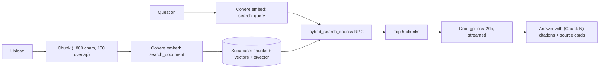

# AskMyDocs: AI Document Q&A with Cited Answers

[](https://github.com/ayush-s-tomar/intellect-docs-ai/actions/workflows/ci.yml)
[](LICENSE)
[](https://intellect-docs-ai.vercel.app)


Upload a document and ask questions about it in plain English.
Answers are generated only from your document and shown next to the exact chunks they came from, with each chunk's cosine similarity.

**[Live demo](https://intellect-docs-ai.vercel.app)** · [How it works](#how-it-works) · [Engineering decisions](#engineering-decisions) · [Eval](#rag-quality-evaluation) · [Run locally](#run-locally) · [Limitations](#known-limitations)


## Highlights

- **Grounded, cited answers.** The model sees labelled excerpts (`[Chunk 1]` to `[Chunk 5]`), cites them as `(Chunk N)`, and the UI lists the same chunks with their similarity, so every claim can be traced to text.
- **Hybrid retrieval.** pgvector cosine similarity and Postgres full-text search are fused with Reciprocal Rank Fusion, so both semantic matches and exact terms, names and numbers are found.
- **A built-in eval harness** with an LLM judge plus deterministic checks, honest about what it can and cannot prove (see [Eval](#rag-quality-evaluation)).
- **Production hygiene.** CI runs tests, lint, type-check and build on every push. Rate limiting fails open. Server-side input validation. Row Level Security on. Production dependencies audit clean.

## Why this exists

Most "chat with your PDF" demos either hallucinate past the source or hide why an answer was given. AskMyDocs shows its work: every retrieved chunk is visible with its similarity score, and a built-in eval lets retrieval and prompt changes be regression-tested instead of eyeballed.

## Features

- Upload `.txt`, `.md` or `.pdf` (PDF text is extracted in the browser) up to 5 MB, and pick documents from the sidebar
- Streaming answers rendered as markdown, with `(Chunk N)` citations
- Inspect the source chunks behind every answer, with similarity percentages
- Multi-turn follow-ups (the last 6 messages are used to resolve references such as "it")
- Export a chat, delete documents, and run the eval from `/eval`
- Anonymous, session-scoped isolation with no signup

## Tech stack

| Layer | Tech |
| --- | --- |
| Frontend | Next.js 16 (App Router), TypeScript, Tailwind CSS 4 |
| LLM | Groq API, `openai/gpt-oss-20b` |
| Embeddings | Cohere `embed-english-light-v3.0` (384-dim), asymmetric query/document encoding |
| Database | Supabase (PostgreSQL + pgvector) |
| Retrieval | Hybrid: pgvector cosine + Postgres full-text, fused with RRF (k = 60) |
| Rate limiting | Upstash Redis (sliding window) |
| Validation | Zod |
| Tests / CI / hosting | Vitest, GitHub Actions, Vercel |

## How it works



1. **Upload.** `chunker.ts` splits text into sentence-aware chunks (about 800 characters, 150-character overlap). Oversized "sentences" (common in PDF text without punctuation) are split at whitespace or hard-cut, never truncated, and the overlap snaps to a word boundary so a chunk never opens mid-word.
2. **Embed and store.** Each chunk is embedded with `input_type: search_document` and stored with its 384-dimension vector. A generated `tsvector` column keeps full-text search in sync automatically.
3. **Retrieve.** The question is embedded with `input_type: search_query` (Cohere's model is asymmetric). The `hybrid_search_chunks` RPC takes up to 20 candidates from each leg, ranks them separately, fuses the ranks with RRF, and returns the top 5. Every query is scoped to the caller's session and the selected documents.
4. **Answer.** The 5 chunks go to Groq as labelled excerpts. The answer streams back, preceded by a sources event.
5. **Show the work.** The UI renders the markdown answer and the chunk cards with real cosine similarity.

## Engineering decisions

**Retrieval quality**
- **Query/document asymmetry.** Questions were once embedded as `search_document`, which quietly degraded retrieval everywhere. They now use `search_query`.
- **Truncation mismatch.** Chunks were stored at about 800 characters but only the first 512 were embedded. The embed limit now exceeds chunk size, and the chunker hard-splits oversized text so nothing is truncated.
- **Mid-word boundaries.** The overlap now snaps to whitespace (including newlines), with a regression test.
- **Hybrid search.** Full-text search catches names and numbers that embed poorly. The full-text leg ORs the query terms: `websearch_to_tsquery` ANDs them, which returns nothing for a natural-language question and silently turns hybrid into vector-only.
- **Honest similarity.** The percentage on each source card is real cosine similarity. It used to show each chunk's share of the RRF score, which is rank-based and nearly identical across the top results.

**LLM behaviour and eval**
- **Reasoning-model token exhaustion.** `gpt-oss-20b` spends part of `max_tokens` on hidden reasoning, so small budgets returned empty answers with no error. This was only visible by logging `finish_reason`. The eval retries once with a larger budget, and the chat route logs abnormal completions and tells the user when a response is empty or cut off.
- **Judge sees the same context.** The judge used to see a truncated slice of the context, so it penalised correct answers. It now sees exactly what the answerer saw.
- **No reward for lazy refusals.** A "not found" answer scores high only on the deliberate grounding probe. On every other question the judge must check whether the context really lacked the answer.
- **Free-tier rate limits.** The eval waits out Groq's 429 hints, and a failed judge call is reported as unscored instead of being counted as 0.

**Reliability and security**
- **Zero-downtime model migration** when Groq deprecated `llama-3.1-8b-instant`.
- **Fail-open rate limiter.** A Redis outage (an expired free-tier database) once broke uploads and chat. The limiter now logs and allows the request.
- **Server-side validation.** Upload size and type, empty files, NUL characters, UUID session ids, bounded message length and document-id counts. Raw internal error text never reaches the browser.
- **Row Level Security enabled** on both tables with no policies, and all access goes through server routes using the service-role key (`server-only`). The browser holds no Supabase key.
- **SSE parsing buffers** until a full event arrives, so a network read that splits an event does not drop text.

## RAG quality evaluation

`/eval` runs 8 automated questions against one selected document. An LLM judge scores each answer 0 to 10, and deterministic checks run without any LLM:

- `contains_number`: the answer must contain a digit
- `not_found`: for a deliberate grounding probe whose correct answer is "not found"

Open-ended questions report `n/a` rather than a fake pass.

**Latest recorded run (Oct 2026):** Grade **B**, **7.1/10** average, **6 of 8** questions at 6/10 or higher (75%), deterministic checks 3/3, 0 unscored. Document: a 6-week CAT exam study guide (a text file).

| Question | Score |
| --- | --- |
| Main topic | 10 |
| Summarize key points | 10 |
| Most important details | 1 |
| Conclusions | 10 |
| Numbers, dates, statistics | 10 |
| Proper nouns (list them) | 0 |
| Specific numbers / quantities | 6 |
| Grounding probe (should be "not found") | 10 |

**How to read that number.** It is a self-graded regression signal, not a benchmark. The same Groq model family answers and judges, the run covers one document and eight questions, and the eval's QA prompt is simpler than the production chat prompt. The two failures were not retrieval failures: the judge noted the context contained the relevant text, and the model answered "Not found" anyway. Aggregate questions ("list all names", "most important details") are also a structural weakness of top-5 chunk retrieval, which cannot cover a whole document. The numbers question scored 6 because the answer mostly listed section numbers rather than real quantities, which the digit check cannot distinguish. The live `/eval` dashboard is the source of truth.

## Reliability

| Limit | Value |
| --- | --- |
| Chat | 30 requests/minute per IP |
| Upload | 20 uploads/hour per IP |
| Eval | 5 runs/hour per IP (one run makes 16+ model calls) |

- **Fail open.** If Redis is unreachable, the limiter logs and allows the request.
- **Keep-alives.** `/api/health` is pinged by a scheduled GitHub Actions job to keep the Supabase free tier from pausing, and a second job pings Upstash Redis twice a week. GitHub disables scheduled workflows after 60 days without repository activity, so any commit re-arms them.
- **CI.** Every push runs the 28 unit tests, ESLint, `tsc --noEmit` and a production build.
- **Structured logging.** API routes log JSON including the model `finish_reason`, which is how the silent empty-answer bug was found.
- **Dependencies.** `npm audit --omit=dev` reports 0 vulnerabilities (Oct 2026). The remaining findings are in dev-only lint tooling and do not ship.

## Session isolation

On first visit the browser generates a `crypto.randomUUID()` and stores it in `localStorage`. Every upload, fetch, delete and search is scoped server-side by that id, so one visitor never sees another's documents.

This is a deliberate lightweight-auth tradeoff, with two consequences worth stating:

- **The session id is a bearer token.** Anyone holding it can read and delete that session's documents. It is a random UUID, but it is not real authentication.
- **It travels in the URL** for `GET` and `DELETE /api/documents`, so it can appear in server logs.

Clearing browser data, or switching browser or device, starts a new empty session. Moving the id to a request header, and adding optional accounts, are on the roadmap.

## Database schema

`supabase/schema.sql` is idempotent and recreates everything on a fresh project: the pgvector extension, tables, session columns, RLS, the generated `tsvector` column and GIN index, and the `hybrid_search_chunks` and `match_chunks` functions with a pinned `search_path`. There is deliberately no ANN index: every query is filtered to one session and the selected documents first, so an exact scan over that small set is fast and gives exact recall. pgvector is installed in the `public` schema, which is Supabase's default and the one remaining linter warning.

## Project structure

```
.github/workflows/
  ci.yml                 tests, lint, type-check, build
  keepalive-supabase.yml pings /api/health
  keepalive-redis.yml    pings Upstash
src/
  app/
    page.tsx             main UI
    eval/page.tsx        eval dashboard
    api/{chat,upload,documents,eval,health}/route.ts
  hooks/useSessionId.ts
  lib/
    chunker.ts           sentence-aware chunking (+ tests)
    embeddings.ts        Cohere, asymmetric
    chunks-repository.ts RPC calls, context labelling, sources
    evalQuestions.ts     eval question set
    validation.ts        Zod schemas (+ tests)
    ratelimit.ts         Upstash limiters, fail-open helper
    supabase-admin.ts    server-only service-role client
    api-response.ts, config.ts, env.ts, logger.ts
supabase/schema.sql
```

## Run locally

Requires Node 20+, a Supabase project, and Groq, Cohere and Upstash accounts (all have free tiers).

```bash
git clone https://github.com/ayush-s-tomar/intellect-docs-ai.git
cd intellect-docs-ai
npm install
```

1. Run `supabase/schema.sql` in the Supabase SQL editor.
2. Create `.env.local`:

```bash
GROQ_API_KEY=your_groq_key
COHERE_API_KEY=your_cohere_key
NEXT_PUBLIC_SUPABASE_URL=your_supabase_project_url
SUPABASE_SERVICE_ROLE_KEY=your_supabase_service_role_key
UPSTASH_REDIS_REST_URL=your_upstash_rest_url
UPSTASH_REDIS_REST_TOKEN=your_upstash_rest_token
```

3. Start the app and run the checks:

```bash
npm run dev      # http://localhost:3000
npm test         # 28 unit tests
npm run lint
npx tsc --noEmit
```

`SUPABASE_SERVICE_ROLE_KEY` is server-only and must never be exposed to the browser. `NEXT_PUBLIC_SUPABASE_URL` is just the project URL, not a secret.

## Deployment

Deployed on Vercel. Set the six environment variables above in the project settings. For the Supabase keep-alive, add a repository secret `APP_HEALTH_URL` pointing at `/api/health`, and add `UPSTASH_REDIS_REST_URL` and `UPSTASH_REDIS_REST_TOKEN` as repository secrets for the Redis keep-alive.

## Known limitations

- Aggregate questions ("list every name in the document") need more than top-5 chunk retrieval can provide.
- The eval is small, self-graded, and uses a simpler prompt than the chat route.
- Session ids are bearer tokens, not authentication, and documents are never expired.
- PDF text extraction happens in the browser, so scanned (image-only) PDFs are not supported.
- Free-tier rate limits on Groq make the eval slow (1 to 3 minutes).

## Roadmap

- [ ] Share one answering prompt between chat and eval so the eval tests what ships
- [ ] A non-self-graded quality check (a different model family as judge) and a larger, multi-document question set
- [ ] Move the session id from the query string to a request header
- [ ] Expire documents for abandoned sessions
- [ ] Multi-document Q&A with per-document attribution
- [ ] Optional accounts so documents persist across devices

## License

MIT. See [LICENSE](LICENSE).

## Author

Ayush Singh Tomar: [GitHub](https://github.com/ayush-s-tomar) · [LinkedIn](https://linkedin.com/in/ayushsinghtomar) · [Portfolio](https://ayush-s-tomar.vercel.app)