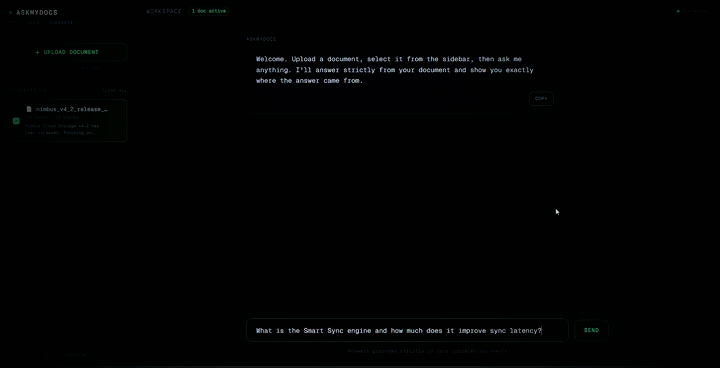
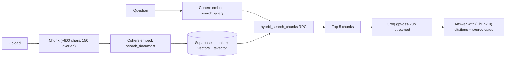

<div align="center">

# AskMyDocs

**Ask questions about your documents. Get answers you can verify.**

Every answer is generated only from your document, cites the chunks it used, and shows each chunk's real cosine similarity.

[](https://github.com/ayush-s-tomar/intellect-docs-ai/actions/workflows/ci.yml)
[](LICENSE)
[](https://intellect-docs-ai.vercel.app)


**[Live demo](https://intellect-docs-ai.vercel.app)** · **[How it works](#how-it-works)** · **[Eval results](#rag-quality-evaluation)** · **[Run locally](#run-locally)** · **[Limitations](#known-limitations)**



</div>

## Try it in 60 seconds

1. Open the **[live demo](https://intellect-docs-ai.vercel.app)**. No signup.
2. Click **Upload Document** and choose any `.txt`, `.md` or `.pdf` (up to 5 MB). No file handy? Download the [sample handbook](https://raw.githubusercontent.com/ayush-s-tomar/intellect-docs-ai/main/samples/company-handbook.txt) (right-click, save as) and upload that. Try: "How many days of paid leave do I get?" or "Who do I report a lost laptop to?"
3. Select it in the sidebar and click an example question, or ask your own.
4. Open the **Sources** under the answer to see the exact chunks and their cosine similarity.
5. Optional: open `/eval` to run the built-in quality check. Questions run one at a time with live progress. The **retrieval check** on the same page needs no LLM, so it works even when the AI provider is rate-limited.

> The demo runs on free tiers. If the AI provider's daily token limit has been reached, the app says so and recovers the next day.

## At a glance

| | |
| --- | --- |
| **What it is** | A retrieval-augmented (RAG) document Q&A app with cited, traceable answers |
| **Retrieval** | Hybrid: pgvector cosine + Postgres full-text, fused with Reciprocal Rank Fusion |
| **Answering** | Groq `openai/gpt-oss-20b`, streamed, citing `(Chunk N)` |
| **Quality** | Built-in eval: LLM judge plus deterministic checks, reported honestly |
| **Engineering** | 45 unit tests, CI on every push, input validation, RLS, rate limiting, clean production audit |
| **Isolation** | Anonymous, session-scoped, no signup |

## Contents

[Features](#features) · [Tech stack](#tech-stack) · [How it works](#how-it-works) · [Engineering decisions](#engineering-decisions) · [Eval](#rag-quality-evaluation) · [Reliability](#reliability) · [Session isolation](#session-isolation) · [Schema](#database-schema) · [Structure](#project-structure) · [Run locally](#run-locally) · [Deployment](#deployment) · [Limitations](#known-limitations) · [Roadmap](#roadmap)

## Why this exists

Most "chat with your PDF" demos either hallucinate past the source or hide why an answer was given. AskMyDocs shows its work: every retrieved chunk is visible with its similarity score, and a built-in eval lets retrieval and prompt changes be regression-tested instead of eyeballed.

## Features

- Upload `.txt`, `.md` or `.pdf` (PDF text is extracted in the browser), up to 5 MB, and pick documents from the sidebar
- Streaming answers rendered as markdown, with `(Chunk N)` citations
- Source cards for every answer, with real cosine similarity
- Multi-turn follow-ups (the last 6 messages resolve references such as "it")
- Example-question chips, chat export, document delete, and an eval dashboard at `/eval`
- Anonymous, session-scoped isolation with no signup

## Tech stack

| Layer | Tech |
| --- | --- |
| Frontend | Next.js 16 (App Router), TypeScript, Tailwind CSS 4 |
| LLM | Groq API, `openai/gpt-oss-20b` |
| Embeddings | Cohere `embed-english-light-v3.0` (384-dim), asymmetric query/document encoding |
| Database | Supabase (PostgreSQL + pgvector) |
| Retrieval | Hybrid: pgvector cosine + Postgres full-text, fused with RRF (k = 60) |
| Rate limiting | Upstash Redis (sliding window) |
| Validation | Zod |
| Tests / CI / hosting | Vitest, GitHub Actions, Vercel |

## How it works



1. **Upload.** `chunker.ts` splits text into sentence-aware chunks (about 800 characters, 150-character overlap). Oversized "sentences" (common in PDF text without punctuation) are split at whitespace or hard-cut, never truncated, and the overlap snaps to a word boundary so a chunk never opens mid-word.
2. **Embed and store.** Each chunk is embedded with `input_type: search_document` and stored with its 384-dimension vector. A generated `tsvector` column keeps full-text search in sync automatically.
3. **Retrieve.** The question is embedded with `input_type: search_query` (Cohere's model is asymmetric). The `hybrid_search_chunks` RPC takes up to 20 candidates from each leg, ranks them separately, fuses the ranks with RRF, and returns the top 5. Every query is scoped to the caller's session and the selected documents.
4. **Answer.** The 5 chunks go to Groq as labelled excerpts. The answer streams back, preceded by a sources event. The same prompt module serves chat and eval, so the eval tests what users get.
5. **Show the work.** The UI renders the markdown answer and the chunk cards with real cosine similarity.

## Engineering decisions

<details>
<summary><b>Retrieval quality</b></summary>

- **Query/document asymmetry.** Questions were once embedded as `search_document`, which quietly degraded retrieval everywhere. They now use `search_query`.
- **Truncation mismatch.** Chunks were stored at about 800 characters but only the first 512 were embedded. The embed limit now exceeds chunk size, and the chunker hard-splits oversized text so nothing is truncated.
- **Mid-word boundaries.** The overlap now snaps to whitespace (including newlines), with a regression test.
- **Hybrid search.** Full-text search catches names and numbers that embed poorly. The full-text leg ORs the query terms: `websearch_to_tsquery` ANDs them, which returns nothing for a natural-language question and silently turns hybrid into vector-only.
- **Honest similarity.** The percentage on each source card is real cosine similarity. It used to show each chunk's share of the RRF score, which is rank-based and nearly identical across the top results.

</details>

<details>
<summary><b>LLM behaviour and eval</b></summary>

- **Reasoning-model token exhaustion.** `gpt-oss-20b` spends part of `max_tokens` on hidden reasoning, so small budgets returned empty answers with no error. This was only visible by logging `finish_reason`. The eval retries once with a larger budget, and the chat route logs abnormal completions and tells the user when a response is empty or cut off.
- **One shared prompt.** Chat and eval build their system prompt from the same module, so the eval measures the prompt users actually get.
- **Refusal wording, measured.** The original prompt made the model answer "Not found" whenever it was unsure. Softening it ("refuse only if nothing relevant exists, otherwise answer partially") moved the numbers question from a repeatable 6 to 9 without breaking the grounding probe.
- **Judge sees the same context.** The judge used to see a truncated slice of the context, so it penalised correct answers. It now sees exactly what the answerer saw.
- **No reward for lazy refusals.** A "not found" answer scores high only on the deliberate grounding probe. On every other question the judge must check whether the context really lacked the answer.
- **Free-tier limits handled.** The eval waits out per-minute 429 hints, stops immediately on the daily token cap with a clear message, and reports a failed judge call as unscored instead of counting it as 0.

</details>

<details>
<summary><b>Reliability and security</b></summary>

- **Zero-downtime model migration** when Groq deprecated `llama-3.1-8b-instant`.
- **Fail-open rate limiter.** A Redis outage (an expired free-tier database) once broke uploads and chat. The limiter now logs and allows the request.
- **Server-side validation.** Upload size and type, empty files, NUL characters, UUID session ids, bounded message length and document-id counts.
- **No internal errors in the browser.** Provider and database error text is logged on the server only. Users see short, fixed messages.
- **Row Level Security enabled** on both tables with no policies. All access goes through server routes using the service-role key (`server-only`), so the browser holds no Supabase key.
- **SSE parsing buffers** until a full event arrives, so a network read that splits an event does not drop text.

</details>

## RAG quality evaluation

`/eval` runs 8 automated questions against one selected document, one request per question, so a dropped connection loses one question and not the whole run. An LLM judge scores each answer 0 to 10, and deterministic checks run without any LLM:

- `contains_number`: the answer must contain a digit
- `not_found`: for a deliberate grounding probe whose correct answer is "not found"

Open-ended questions report `n/a` rather than a fake pass.

**Measured runs (Oct 2026, one 6-week CAT study guide, re-uploaded between runs):**

| Run | Change | Average |
| --- | --- | --- |
| 1 | Original prompts | 7.1 |
| 2 | Same code, re-run | 8.1 |
| 3 | One shared chat/eval prompt | 8.0 |
| 4 | Softer refusal wording | 8.4 |
| 5 | Exact-term question reworded | 8.9 (7 of 8 scored; 1 judge call failed and was excluded) |
| 6 | Same code, fresh upload | 9.3 (all 8 scored) |

Runs vary by about a point with no code change (runs 1 and 2), so treat the overall number as "roughly 8 to 9 on the current code, about 7 before the prompt and wording changes". The specific changes that held up are the ones that fixed a question that failed every time.

**Per-question scores from run 6 (all 8 scored):**

| Question | Score |
| --- | --- |
| Main topic | 10 |
| Summarize key points | 10 |
| Most important details | 8 |
| Conclusions | 10 |
| Numbers, dates, statistics | 9 |
| Exact term lookup (reworded) | 10 |
| Specific numbers / quantities | 7 |
| Grounding probe (should be "not found") | 10 |

**Note on the exact-term question.** It originally asked for "names, products, or proper nouns". On a study guide the model answered "Not found" every time, although the judge saw acronyms like CAT, VARC and DILR in the context. That is a question-design problem, not retrieval, so it was reworded to "specific terms, acronyms, section names or exam names", and it then scored 8, then 10. The earlier 0s (old wording, runs 1 to 4) are reported here, not hidden.

**How to read these numbers.** They are a self-graded regression signal, not a benchmark: the same Groq model family answers and judges, the set is 8 questions on one document, and the digit check cannot tell real quantities from section numbers. Aggregate questions ("list every name") are also a structural limit of top-5 chunk retrieval. The live `/eval` dashboard is the source of truth.

## Reliability

| Limit | Value |
| --- | --- |
| Chat | 30 requests/minute per IP |
| Upload | 20 uploads/hour per IP |
| Eval | 40 question evaluations/hour per IP (about 5 full runs; one question = 2 model calls) |

- **Data retention.** A daily Vercel cron (`/api/cron/cleanup`, protected by a secret, fails closed) deletes documents older than 14 days together with their chunks.
- **Fail open.** If Redis is unreachable, the limiter logs and allows the request.
- **Daily provider cap.** When Groq's free daily token limit is reached, chat and eval say so plainly instead of failing with a generic error.
- **Keep-alives.** `/api/health` is pinged by a scheduled GitHub Actions job to keep the Supabase free tier from pausing, and a second job pings Upstash Redis twice a week. GitHub disables scheduled workflows after 60 days without repository activity, so any commit re-arms them.
- **CI.** Every push runs the 45 unit tests, ESLint, `tsc --noEmit` and a production build.
- **Structured logging.** API routes log JSON including the model `finish_reason`, which is how the silent empty-answer bug was found.
- **Dependencies.** `npm audit --omit=dev` reports 0 vulnerabilities (Oct 2026). The remaining findings are in dev-only lint tooling and do not ship.

## Session isolation

On first visit the browser generates a `crypto.randomUUID()` and stores it in `localStorage`. Every upload, fetch, delete and search is scoped server-side by that id, so one visitor never sees another's documents.

This is a deliberate lightweight-auth tradeoff, with consequences worth stating:

- **The session id is a bearer token.** Anyone holding it can read and delete that session's documents. It is a random UUID, but it is not real authentication.
- **It is sent in an `x-session-id` header**, not the URL, so it does not appear in access logs or browser history. It still lives in `localStorage`, so it is exposed to any script running on the page.

Clearing browser data, or switching browser or device, starts a new empty session. Optional accounts are on the roadmap.

## Database schema

`supabase/schema.sql` is idempotent and recreates everything on a fresh project: the pgvector extension, tables, session columns, RLS, the generated `tsvector` column and GIN index, the `hybrid_search_chunks` and `match_chunks` functions with a pinned `search_path`, and the service-role grants. There is deliberately no ANN index: every query is filtered to one session and the selected documents first, so an exact scan over that small set is fast and gives exact recall. pgvector is installed in the `public` schema, which is Supabase's default and the one remaining linter warning.

## Project structure

```
.github/workflows/
  ci.yml                 tests, lint, type-check, build
  keepalive-supabase.yml pings /api/health
  keepalive-redis.yml    pings Upstash
src/
  app/
    page.tsx             main UI
    eval/page.tsx        eval dashboard (one question per request)
    eval/retrieval/page.tsx  LLM-free retrieval check
    api/{chat,upload,documents,eval,health}/route.ts
  hooks/useSessionId.ts
  lib/
    chunker.ts           sentence-aware chunking (+ tests)
    embeddings.ts        Cohere, asymmetric
    chunks-repository.ts RPC calls, context labelling, sources
    prompts.ts           the one answering prompt (+ tests)
    groq-errors.ts       per-minute vs daily limit detection (+ tests)
    evalQuestions.ts     eval question set
    evalSummary.ts       eval grading maths (+ tests)
    retrievalEval.ts     retrieval hit-rate cases and maths (+ tests)
    validation.ts        Zod schemas (+ tests)
    ratelimit.ts         Upstash limiters, fail-open helper
    supabase-admin.ts    server-only service-role client
    api-response.ts, config.ts, env.ts, logger.ts
supabase/schema.sql
```

## Run locally

Requires Node 20+, a Supabase project, and Groq, Cohere and Upstash accounts (all have free tiers).

```bash
git clone https://github.com/ayush-s-tomar/intellect-docs-ai.git
cd intellect-docs-ai
npm install
```

1. Run `supabase/schema.sql` in the Supabase SQL editor.
2. Create `.env.local`:

```bash
GROQ_API_KEY=your_groq_key
COHERE_API_KEY=your_cohere_key
NEXT_PUBLIC_SUPABASE_URL=your_supabase_project_url
SUPABASE_SERVICE_ROLE_KEY=your_supabase_service_role_key
UPSTASH_REDIS_REST_URL=your_upstash_rest_url
UPSTASH_REDIS_REST_TOKEN=your_upstash_rest_token
```

3. Start the app and run the checks:

```bash
npm run dev      # http://localhost:3000
npm test         # 45 unit tests
npm run lint
npx tsc --noEmit
```

`SUPABASE_SERVICE_ROLE_KEY` is server-only and must never be exposed to the browser, and it must be the **service_role** key, not the anon key. `NEXT_PUBLIC_SUPABASE_URL` is just the project URL, not a secret.

## Deployment

Deployed on Vercel. Set the six environment variables above in the project settings. For the Supabase keep-alive, add a repository secret `APP_HEALTH_URL` pointing at `/api/health`, and add `UPSTASH_REDIS_REST_URL` and `UPSTASH_REDIS_REST_TOKEN` as repository secrets for the Redis keep-alive.

## Known limitations

- Aggregate questions ("list every name in the document") need more than top-5 chunk retrieval can provide.
- The eval is small (8 questions, one document) and self-graded, and its scores vary by about a point between runs.
- The free Groq tier caps usage at a daily token limit; each eval run uses a large share of it, so the demo can be unavailable until the next day.
- Session ids are bearer tokens, not authentication. Documents are deleted automatically after 14 days.
- PDF text extraction happens in the browser, so scanned (image-only) PDFs are not supported.

## Roadmap

- [x] One answering prompt shared by chat and eval
- [x] A retrieval check with known facts (hit@k, MRR), measured separately from the LLM
- [ ] A larger eval set with expected answers for the LLM-graded questions
- [ ] A non-self-graded quality check (a different model family as judge)
- [x] Session id moved from the query string to a request header
- [x] Expire documents after 14 days (daily cron)
- [ ] Multi-document Q&A with per-document attribution
- [ ] Optional accounts so documents persist across devices

## License

MIT. See [LICENSE](LICENSE).

## Author

Ayush Singh Tomar: [GitHub](https://github.com/ayush-s-tomar) · [LinkedIn](https://linkedin.com/in/ayushsinghtomar) · [Portfolio](https://ayush-s-tomar.vercel.app)

See also: SalesAgent, an autonomous B2B lead-research and outreach agent, and resume-screener-lora, a LoRA fine-tuned resume screening model.